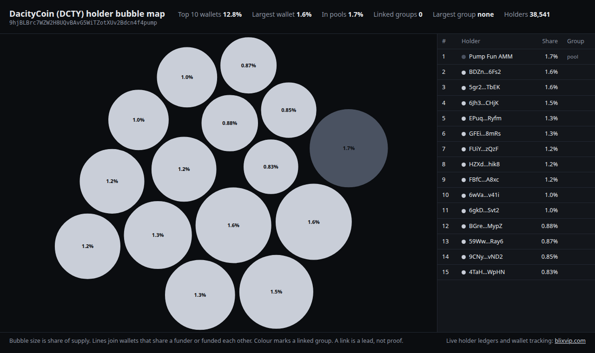
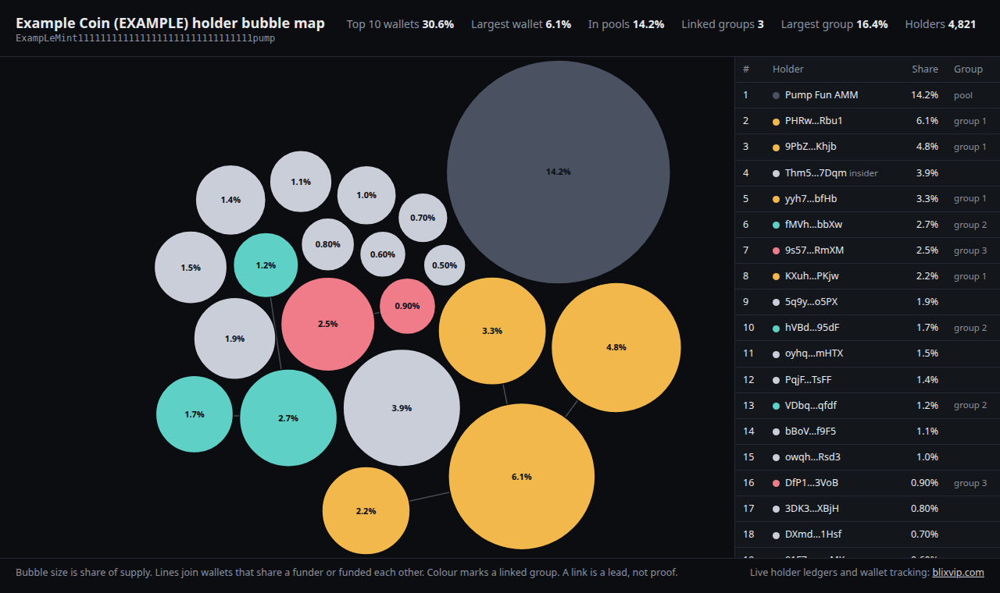

# Solana Bubble Map

Holder bubble map for any Solana or pump.fun token. Shows who holds the supply and which top holders are linked to each other, as an interactive page you can open in your browser.

  [](LICENSE) [](https://blixtrade.github.io/solana-bubble-map/)

> Free and open source, part of the [Blix Trade](https://github.com/blixtrade) toolkit. For the live version with AI ratings on every coin, wallet tracking and one-click trading at 0% fees, see **[BLIX, the Solana memecoin terminal](https://blixvip.com/memecoin-analytics?utm_source=github&utm_medium=readme&utm_campaign=solana-bubble-map)**.





<sub>The second image uses made-up example data to show what linked groups look like.</sub>

**Try it without installing:** live maps of [BONK](https://blixtrade.github.io/solana-bubble-map/bonk/), [WIF](https://blixtrade.github.io/solana-bubble-map/wif/) and [POPCAT](https://blixtrade.github.io/solana-bubble-map/popcat/).

## What it does

- Loads the top 20 holders of any SPL token and checks each one against the chain, so closed accounts and stale balances are dropped.
- Traces who first funded every holder wallet and links wallets that share a funder or funded each other. Linked wallets are coloured as one group: the classic sign of a dev or a bundle spreading supply over many wallets.
- Labels liquidity pools (Raydium, PumpSwap, Meteora, Orca) and leaves them out of the concentration numbers.
- Writes one self-contained HTML file: draggable bubbles, hover details, click through to Solscan. No server, no tracking, nothing loaded from the internet.

## Quick start

You need [Node.js](https://nodejs.org) 22 or newer. There is nothing else to install: no dependencies, no API keys.

Run it straight from GitHub:

```bash
npx -y github:blixtrade/solana-bubble-map <mint>
```

Or clone it:

```bash
git clone https://github.com/blixtrade/solana-bubble-map.git
cd solana-bubble-map
node bin/bubble-map.js <mint>
```

To get a `bubble-map` command on your PATH, run `npm link` inside the folder.

## Example output

Real output from a run on 18 November 2026:

```text
DacityCoin (DCTY)  9hjBLBrc7WZW2H8UQvBAvG5WiTZotXUv2Bdcn4f4pump
Top 10 wallets 12.8%  ·  largest wallet 1.6%  ·  in pools 1.7%  ·  38,541 holders

  #  Holder                      Share  Group     Funded by
  1  Pump Fun AMM                1.68%  pool
  2  BDZnR…N6Fs2                 1.59%            too active to trace
  3  5gr29…oTbEK                 1.58%            5ndLn…oHEPs
  4  6Jh3y…jCHjK                 1.50%            5tzFk…vuAi9
  5  EPuq2…aRyfm                 1.35%            too active to trace
  6  GFEiw…L8mRs                 1.27%            too active to trace
  7  FUiY5…pzQzF                 1.18%            6LY1J…ZzkzF
  8  HZXdw…ihik8                 1.16%            too active to trace
  9  FBfCh…1A8xc                 1.15%            F7p3d…cgmNe
 10  6wVaq…Yv41i                 1.01%            too active to trace
 11  6gkDf…KSvt2                 1.00%            too active to trace
 12  BGre5…yMypZ                 0.88%            too active to trace
 13  59WwR…ZRay6                 0.87%            too active to trace
 14  9CNyL…7vND2                 0.85%            too active to trace
 15  4TaHu…FWpHN                 0.83%            too active to trace

No linked wallet groups found among the top holders.

Bubble map written to bubble-map-DCTY.html
```

## Options

```text
solana-bubble-map: holder bubble map for any Solana token

Usage:
  bubble-map <mint> [options]

Options:
  --top <n>      Holders to map, 5 to 20 (default 20)
  --out <file>   Where to write the HTML page (default bubble-map-<SYMBOL>.html)
  --no-links     Skip funder tracing: instant, but no wallet links
  --depth <n>    Pages of 1,000 transactions to read per wallet when looking
                 for its first funder, 1 to 10 (default 2)
  --group-busy   Also group wallets whose shared funder is a high-activity
                 wallet (an exchange, an app or a distributor)
  --open         Open the page in your browser when done
  --json         Print the data as JSON instead of writing a page
  --help         Show this help

Environment:
  SOLANA_RPC_URL   Your own RPC endpoint (faster tracing than the public one)
```

## How it works

- Holders and labels come from the free RugCheck API and are then verified with one `getMultipleAccounts` call, because RugCheck sometimes lists closed accounts.
- For each wallet the tool pages back through its history (2,000 transactions by default) to its first transaction and reads who sent it SOL.
- Shared funders with very long histories are usually exchanges or trading apps. Sharing one says nothing, so those links are reported but not grouped (use `--group-busy` to group them anyway).
- Grouping is a union-find over the links, so A-B and B-C put A, B and C in one group.

## Limits

- The free public RPC is slow: about one request a second. 20 holders take 1 to 4 minutes. Set `SOLANA_RPC_URL` to your own endpoint (a free Helius or QuickNode key works) to make it fast.
- Very active wallets (bots, market makers) have more history than the tool reads and are marked "too active to trace". Raise `--depth` to go further back.
- A shared funder is a lead, not proof. Friends fund each other, and so do services.

## Development

```bash
npm test
```

Tests run offline against fixtures, so they never depend on a live API.

## Contributing

Pull requests are welcome, and first-timers are too. Pick an issue labelled [good first issue](https://github.com/blixtrade/solana-bubble-map/issues?q=is%3Aissue+is%3Aopen+label%3A%22good+first+issue%22) or [help wanted](https://github.com/blixtrade/solana-bubble-map/issues?q=is%3Aissue+is%3Aopen+label%3A%22help+wanted%22), comment that you are taking it, and read [CONTRIBUTING.md](CONTRIBUTING.md). No API keys needed: the tests run offline.

[](https://github.com/blixtrade/solana-bubble-map/graphs/contributors)

## More free Solana tools from Blix Trade

| Tool | What it does |
|---|---|
| [pump-fun-tracker](https://github.com/blixtrade/pump-fun-tracker) | Every new pump.fun launch on Solana, live in your terminal, the moment it is created. |
| [solana-rug-checker](https://github.com/blixtrade/solana-rug-checker) | Rug pull scanner for Solana and pump.fun tokens. |
| [solana-memecoin-screener](https://github.com/blixtrade/solana-memecoin-screener) | Screen trending, new and boosted Solana memecoins from the terminal. |
| [solana-wallet-tracker](https://github.com/blixtrade/solana-wallet-tracker) | Follow any Solana wallets and see every memecoin buy and sell they make: token, size in SOL and USD, and a Solscan link. |
| [solana-pnl-tracker](https://github.com/blixtrade/solana-pnl-tracker) | Profit and loss for any Solana wallet's memecoin trades, worked out from its on-chain transactions. |
| [solana-whale-tracker](https://github.com/blixtrade/solana-whale-tracker) | Big buys and sells on any Solana token: net whale flow, every large trade with a Solscan link, and leaderboards of the wallets buying and dumping the most. |
| [memecoin-paper-trading](https://github.com/blixtrade/memecoin-paper-trading) | Practise Solana memecoin trading with fake SOL at real prices. |
| [memecoin-alert-bot](https://github.com/blixtrade/memecoin-alert-bot) | pump.fun alerts in Telegram and Discord. |
| [pump-fun-mcp](https://github.com/blixtrade/pump-fun-mcp) | An MCP server that gives Claude, Cursor and other AI assistants six Solana memecoin research tools: token info, rug check, top holders, a screener, whale trades and wallet trades. |

Want all of this in one place, live, with AI on every coin? **[Open BLIX](https://blixvip.com/?utm_source=github&utm_medium=readme&utm_campaign=solana-bubble-map)**: the Solana memecoin terminal with 0% trading fees.

## Disclaimer

This is research software, not financial advice. Memecoins are extremely volatile and most go to zero. Never trade more than you can afford to lose. The data comes from free third-party APIs that can be wrong, late or unavailable.

## License

[MIT](LICENSE)
